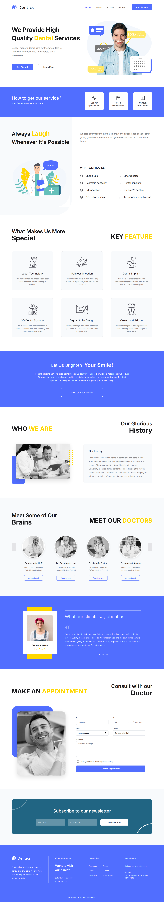

# Dentics Dental Clinic: custom WordPress theme

A dental clinic website built as a **custom WordPress theme from a Figma design**, with no page builder.



## Live demos
- **Static preview (fast):** https://dentics-dental-clinic.vercel.app
- **Real WordPress demo (runs in your browser, includes wp-admin):** [Open in WordPress Playground](https://playground.wordpress.net/?blueprint-url=https://raw.githubusercontent.com/dhruvinsidpara/dentics-wordpress-theme/main/playground-blueprint.json)

## Features
- 11 sections built close to the Figma design:
  - Hero, how-it-works steps, services
  - Key features, call to action, about
  - Doctors slider, testimonial, appointment form
  - Newsletter, footer
- Responsive at desktop, tablet and mobile, with a mobile menu
- **Editable without code:** Appearance → Customize → *Dentics homepage* (hero, about, testimonial, hours, email, address)
- **Appointment form:** server-side validation, nonce protection, emails the clinic, and success/error messages
- Clean PHP templates, escaped output, vanilla JS (no jQuery), accessible markup (skip link, labels, focus styles, reduced-motion support)

## Tech
WordPress (classic theme) · PHP · HTML · CSS · JavaScript · Figma

## Run locally
No PHP or Docker needed; this uses [WordPress Playground](https://wordpress.github.io/wordpress-playground/):

```bash
npx @wp-playground/cli@latest server --port=9400 \
  --mount=./theme:/wordpress/wp-content/themes/dentics --blueprint=./blueprint.json
```

Open http://127.0.0.1:9400 (local test admin: `admin` / `password`).
If downloads time out, prefix the command with `NODE_OPTIONS="--network-family-autoselection-attempt-timeout=1000"`.

Or install the theme on any WordPress site: zip the `theme/` folder, then go to Appearance → Themes → Add New → Upload.

## Credits
Design: ["Landing Page for Dental Clinic"](https://www.figma.com/community/file/1157710179859282865/landing-page-for-dental-clinic) by Mahmud Saeef, Figma Community, licensed [CC BY 4.0](https://creativecommons.org/licenses/by/4.0/). Development: Dhruvin S.
